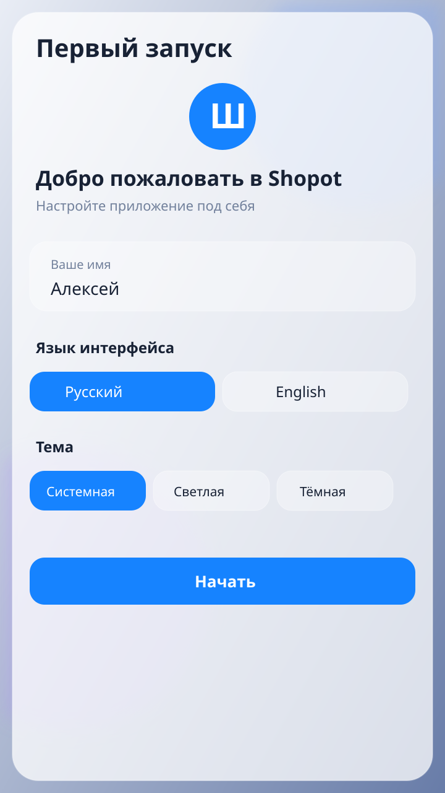
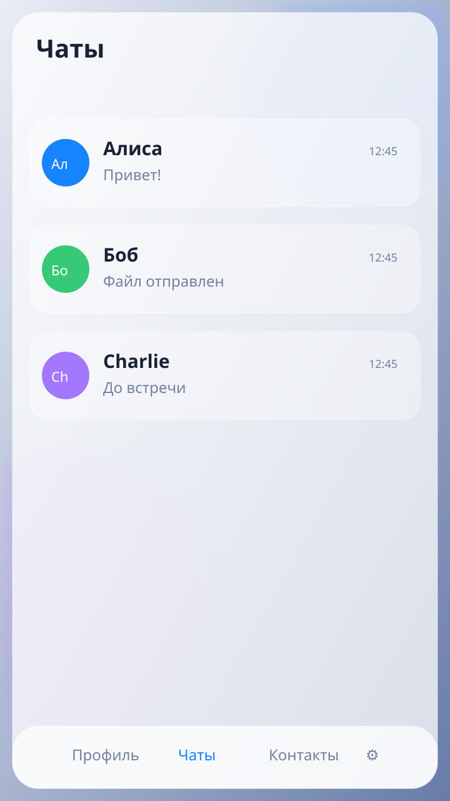
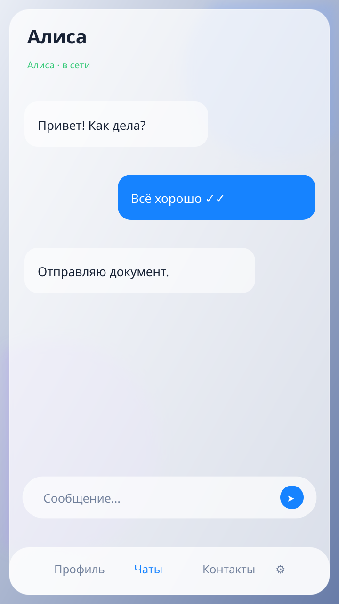
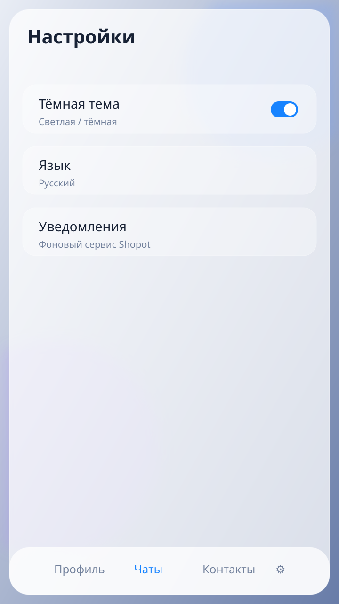

# Stille Messenger (Android)

**English** | [Русский](ru/README.md)

Serverless P2P messenger Android client for the [shopot-core](https://github.com/Puxxalwl/shopot-core) daemon.

## Features

- **P2P — no servers.** Direct TCP (ports 7777–7786), LAN discovery, or
  self-hosted relay (IP hiding).
- **End-to-end encrypted.** The client never touches keys — the `shopot serve`
  daemon owns all cryptography (double ratchet, AEAD, forward secrecy).
- **No telemetry, no analytics, no Firebase.**
- **Glassmorphism UI** — iPhone-style translucent panels with blur.
- **Rich messages** — bold, italic, strikethrough, spoiler, code, links.
- **Reactions** — any Unicode emoji.
- **Files & photos** — up to 64 MB, resumable.
- **Voice calls** — 16 kHz E2EE with ADPCM+DTX.
- **Offline delivery** — encrypted outbox with ACKs and dedup.

## Screenshots

Generated examples are in [docs/screenshots](docs/screenshots):






Regenerate them with `python3 tools/generate_screenshots.py`. The supplied
Stille logo is stored at `app/src/main/res/drawable-nodpi/stille_logo.png`.

## First launch

On the first launch, Stille Messenger opens a local welcome setup where you choose the
interface language, light/system/dark theme, and the name shown on your profile.
These choices are stored locally on the device and can be changed later in the
app settings/profile.


Stille means “silence” in German. Names are limited to 1–32 UTF-8 bytes, matching
the core (16 Cyrillic letters or 8 four-byte emoji). Continue stays at the bottom
while the form scrolls. The Android application ID is now `com.stille.messenger`; this is a separate installation without automatic migration of old data.

## Setup

### Prerequisites
- Android 8.0+ (API 26)
- JDK 17
- [Zig 0.17.0](https://ziglang.org/download/) (for building shopot-core)

### Build

```bash
# 1. Build shopot-core binary for Android arm64-v8a
./tools/build-core.sh

# 2. Build the Android app
./gradlew :app:assembleDebug

# 3. (optional) Run tests
./gradlew :data:testDebugUnitTest :app:testDebugUnitTest

# Fast incremental Kotlin check (keeps Gradle/Kotlin daemons warm)
./gradlew :app:compileDebugKotlin --daemon --offline --max-workers=2
```

### Architecture

```
app/                      # Android app: Compose UI + foreground service
├── ui/                   # Compose screens, components, theme
├── service/              # StilleService (foreground) + BootReceiver
data/                     # Protocol codec (matches CORE-API.md byte-for-byte)
tools/                    # Cross-compile scripts for shopot-core
core-src/                 # shopot-core source (git submodule / cloned)
```

The `data` module implements the binary UDS protocol codec. The
`StilleService` foreground service:
1. Extracts and starts the `shopot` binary from assets
2. Connects to `~/.shopot/api.sock` (UDS)
3. Sends `GET_VERSION` to verify core compatibility
4. Listens for events and broadcasts them to the UI via `StateFlow`

### Adding a friend

Open the invite action from Chats or Contacts. Stille creates a one-time invite
through the binary `CREATE_INVITE` API and keeps it in memory only. You can share
the link, copy it, or show a black-and-white QR with the symbol-only Stille mark
(no wordmark). The recipient can paste the link or choose a QR image; Stille
accepts it through `ACCEPT_INVITE` and shows the contact only after the trusted
`CONTACT_JOINED` event.

```
A: CREATE_INVITE → "shopot://i/ABC123..."
   (share over any messenger or QR)
B: ACCEPT_INVITE → wait for CONTACT_JOINED → connected
```

## Documentation

| Document | Content |
|---|---|
| [AGENTS.md](AGENTS.md) | Contributor contract for the Android client |
| [CONTRIBUTING.md](CONTRIBUTING.md) | How to contribute |
| [DOCS.md](DOCS.md) | Documentation writing rules |
| [SECURITY.md](SECURITY.md) | Security policy |
| [CHANGELOG.md](CHANGELOG.md) | Changelog |

For the core API specification, see:
[`core-src/zig/docs/CORE-API.md`](core-src/zig/docs/CORE-API.md) or the
upstream [shopot-core](https://github.com/puxxalwl/shopot-core).

## Linux client

The official Linux desktop client is [EryyynIT/shopot](https://github.com/EryyynIT/shopot).
It is built with Rust and iced, uses the same shopot-core daemon and binary
UDS API, and is the reference desktop client for cross-platform UX and
integration behavior. This Android project shares the core contract but does
not copy Linux client source code.

## License

The original Android client code is licensed under **AGPL-3.0-or-later**.
All forks, modified versions, and redistributions of covered work must use the
same license and retain attribution to `puxxalwl` and `EryyynIT`. See
[LICENSE](LICENSE), [LICENSE-AGPL-3.0.txt](LICENSE-AGPL-3.0.txt), and
[NOTICE](NOTICE).

The `core-src/` submodule is an independent shopot-core project and retains
its upstream MIT license. The Linux client [EryyynIT/shopot](https://github.com/EryyynIT/shopot)
is referenced for UX/integration and is not copied into this repository.
