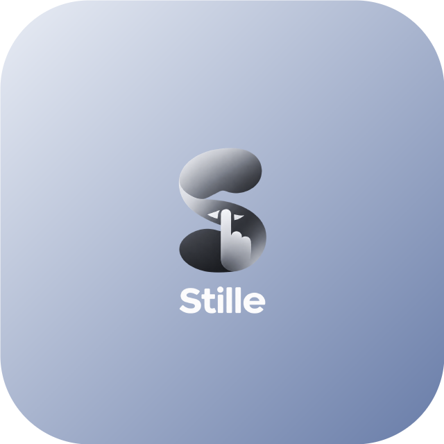
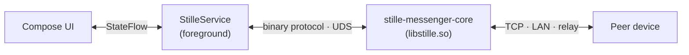

<p align="center">
  
</p>
<h1 align="center">Stille Messenger</h1>

<p align="center">
  Serverless end-to-end-encrypted messenger for Android.<br>
  Client of the <a href="https://github.com/puxxalwl/stille-messenger-core">stille-messenger-core</a> daemon.
</p>

<p align="center">
  <a href="https://github.com/Puxxalwl/Stille-Messenger-Android/actions/workflows/ci.yml"></a>
  <a href="LICENSE"></a>
  
  
</p>

<p align="center"><strong>English</strong> · <a href="ru/README.md">Русский</a></p>

---

## What Stille is


*Stille* is German for “silence”. The messenger connects two devices
directly — over TCP, LAN discovery or a self-hosted relay — with no
operator servers in between. The client contains no telemetry, no
analytics and no third-party SDKs.

All cryptography, message storage and transport belong to the
[core](https://github.com/puxxalwl/stille-messenger-core): a single static
binary the app runs locally and talks to over a Unix socket. The client
never touches keys, and nothing is written to disk in plaintext.

## In this client

- Chats with formatted messages: bold, italic, strikethrough, spoiler,
  code, links — over UTF-8 entity ranges, safe for emoji.
- Reactions with any Unicode emoji.
- Contacts through one-time or permanent invites: QR with live camera
  scanning, saved QR images, links and `stille://` deeplinks.
- Profile with an avatar stored by the core in encrypted form.
- Account recovery: a passkey plus one core-sealed file in your own cloud
  restores the identity on a new device — without the message history
  ([details](docs/RECOVERY.md)).
- Self-updates: APKs from GitHub Releases, verified by checksum, signing
  certificate and version before installation.
- English and Russian interface.

File transfer (up to 64 MB) and 16 kHz E2EE voice calls are defined by
the core API but not yet implemented in this client.

## Architecture



| Module | Role |
|---|---|
| `app/` | Compose UI, foreground service, recovery and update flows |
| `data/` | Binary protocol codec — mirrors `CORE-API.md` byte-for-byte |
| `tools/` | Cross-compilation and release scripts |
| `core-src/` | Core source (git submodule, not a Gradle module) |

The service executes the core binary from `nativeLibraryDir`, provisions
the identity once, then forwards core events to the UI as `StateFlow`.
[How the client works](docs/ARCHITECTURE.md).

## Documentation

| Document | Content |
|---|---|
| [docs/USAGE.md](docs/USAGE.md) | Using the app: setup, invitations, profile, updates |
| [docs/BUILD.md](docs/BUILD.md) | Building, testing, signing and publishing releases |
| [docs/ARCHITECTURE.md](docs/ARCHITECTURE.md) | Client internals and the core boundary |
| [docs/RECOVERY.md](docs/RECOVERY.md) | Account recovery ceremony and storage providers |
| [docs/UI-DESIGN.md](docs/UI-DESIGN.md) | UI direction for contributors |
| [CONTRIBUTING.md](CONTRIBUTING.md) | Contribution rules |
| [SECURITY.md](SECURITY.md) | Security policy |
| [CHANGELOG.md](CHANGELOG.md) | Release history |

The wire protocol is specified in the core repository:
[`core-src/core/docs/CORE-API.md`](core-src/core/docs/CORE-API.md).

## Build

Requires JDK 17, the Android SDK and [Zig 0.17.0](https://ziglang.org/download/)
(only for cross-compiling the core). Output is an `arm64-v8a` APK.

```bash
bash ./tools/build-core.sh     # core → app/src/main/jniLibs/arm64-v8a/libstille.so
./gradlew :app:assembleDebug   # the app
./gradlew :data:testDebugUnitTest :app:testDebugUnitTest   # tests
```

Release builds need a signing keystore — see [docs/BUILD.md](docs/BUILD.md).

## Project family

| Project | Role |
|---|---|
| [stille-messenger-core](https://github.com/puxxalwl/stille-messenger-core) | Zig daemon: crypto, storage, transport |
| Stille Messenger (this repo) | Android client |
| [EryyynIT/shopot](https://github.com/EryyynIT/shopot) | Linux reference client, Rust + iced |
| [stille.im](https://stille.im) | Website — the invite domain is a redirector only |

## Contributing

Read [CONTRIBUTING.md](CONTRIBUTING.md) before opening a PR — it lists the
invariants reviewers enforce (no telemetry, no client-side crypto, binary
protocol only). Contributor contract for agents and humans:
[AGENTS.md](AGENTS.md).

## License

Original Android client code: **AGPL-3.0-or-later**, Copyright (c) 2026
puxxalwl, EryyynIT. Forks and redistributions keep the same license and
attribution. See [LICENSE](LICENSE), [NOTICE](NOTICE) and the full text in
[LICENSE-AGPL-3.0.txt](LICENSE-AGPL-3.0.txt). The `core-src/` submodule is
an independent project under its own MIT license.
