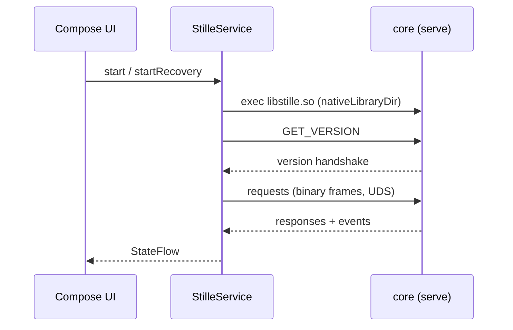

# How the Android client works

**English** | [Русский](../ru/ARCHITECTURE.md)

For contributors and client implementers. User-facing behavior is in
[USAGE.md](USAGE.md); the build pipeline in [BUILD.md](BUILD.md).

## One sentence

The client is rendering and transport glue: a Compose UI driven by a
foreground service, which runs the core binary and talks to it over a
Unix-domain socket using the binary framed protocol from
[`core-src/core/docs/CORE-API.md`](../core-src/core/docs/CORE-API.md).

All decisions about cryptography, protocol and persistence belong to
[stille-messenger-core](https://github.com/puxxalwl/stille-messenger-core);
this repository follows them and never invents its own.

## Modules

| Module | Role |
|---|---|
| `app/` | Compose UI (screens, components, theme), `StilleService`, DI |
| `app/…/service/` | Foreground service: core lifecycle, UDS client, event stream |
| `app/…/backup/` | Recovery blob upload/download (Drive, WebDAV) |
| `app/…/update/` | Verified in-app updates from GitHub Releases |
| `app/…/diag/` | Redacted diagnostics logging |
| `data/` | Protocol codec: frames, methods, events, generated constants |
| `tools/` | `build-core.sh`, release signing helpers, codec generation |
| `core-src/` | Core source — a git submodule, not a Gradle module |

The codec (`data/src/main/java/com/stille/coreapi/`) is partially
generated from `CORE-API.md` by `tools/generate_core_objects.py` and pins
the core API version (`2.8.0`, 54 methods). Method ids, event ids and the
16-byte little-endian frame header must match the specification
byte-for-byte; the wire never carries JSON.

## Service lifecycle

`StilleService` is the only owner of the core process:

1. Executes `libstille.so` from Android's `nativeLibraryDir` (an
   executable, not JNI — no Kotlin-native bridge).
2. Provisions the local identity once via `core init`, never overwriting
   an existing seed. In recovery mode it starts *unprovisioned*
   (`serve` without a seed) and waits for `RESTORE_RECOVERY_BACKUP`.
3. Runs the daemon: `serve`, exposing the UDS API at
   `~/.stille-messenger/api.sock`.
4. Sends `GET_VERSION` to verify core compatibility before anything else.
5. Listens for core events and republishes them to the UI as `StateFlow`;
   all UDS I/O runs off the main thread.

The UI never trusts unconfirmed state: contact name, identity and avatar
are rendered only after the authenticated `CONTACT_JOINED` event.

## Boundaries the client enforces

- **No plaintext on disk.** Avatars and files live in the core's encrypted
  store; client caches are memory-only and bounded (≤ 200 messages per
  chat, ≤ 20 avatars, ≤ 50 MB files). The only exception is a verified,
  temporary public APK from GitHub Releases in the private cache for
  user-confirmed installation.
- **No client-side crypto.** Keys, ratchets and sealed storage belong to
  the core.
- **No duplicates.** The core deduplicates on the wire; the client keeps
  sequence checks and message-id dedup so the UI never shows a message
  twice.
- **No secrets in logs.** Diagnostics contain fixed stage names and
  exception types — never message bodies, identities, invite codes or core
  output. The hidden diagnostics entry (five taps on **About Stille**)
  shares only this redacted file.

## Tracking the core

`core-src/` is a submodule of the core repository. Wire changes land in
the core's `CHANGELOG.md` and `CORE-API.md` before the client implements
them; check both before adding a method or event to the codec. A wire
change requires updating the codec and this repository's `CHANGELOG.md`
in the same commit.

The Linux client [EryyynIT/shopot](https://github.com/EryyynIT/shopot)
implements the same contract; it is the reference for cross-platform UX
and integration behavior, and no code is shared.
