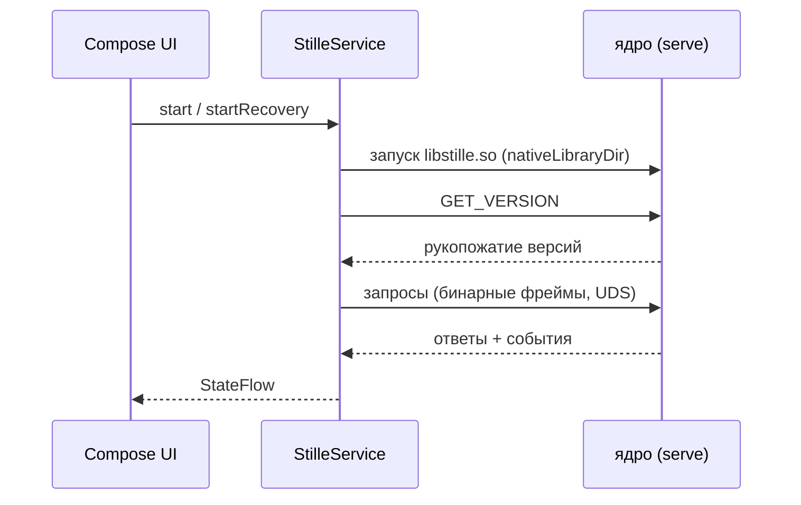

# Как устроен Android-клиент

[English](../docs/ARCHITECTURE.md) | **Русский**

Для контрибьюторов и разработчиков клиентов. Поведение для пользователя —
в [USAGE.md](USAGE.md); сборочная цепочка — в [BUILD.md](BUILD.md).

## Одним предложением

Клиент — рендеринг и транспортный клей: Compose-интерфейс, управляемый
foreground-сервисом, который запускает бинарник ядра и общается с ним по
Unix-сокету бинарным фреймовым протоколом из
[`core-src/core/docs/CORE-API.md`](../core-src/core/docs/CORE-API.md).

Все решения о криптографии, протоколе и хранении принадлежат
[stille-messenger-core](https://github.com/puxxalwl/stille-messenger-core);
этот репозиторий следует им и ничего своего не изобретает.

## Модули

| Модуль | Роль |
|---|---|
| `app/` | Compose-интерфейс (экраны, компоненты, тема), `StilleService`, DI |
| `app/…/service/` | Foreground-сервис: жизненный цикл ядра, UDS-клиент, поток событий |
| `app/…/backup/` | Выгрузка/загрузка recovery-блоба (Drive, WebDAV) |
| `app/…/update/` | Проверенные обновления из GitHub Releases |
| `app/…/diag/` | Обезличенное диагностическое логирование |
| `data/` | Кодек протокола: фреймы, методы, события, сгенерированные константы |
| `tools/` | `build-core.sh`, помощники подписи релизов, генерация кодека |
| `core-src/` | Исходники ядра — git-сабмодуль, не Gradle-модуль |

Кодек (`data/src/main/java/com/stille/coreapi/`) частично сгенерирован из
`CORE-API.md` скриптом `tools/generate_core_objects.py` и закрепляет версию
API ядра (`2.8.0`, 54 метода). Идентификаторы методов и событий и
16-байтовый little-endian заголовок фрейма должны совпадать со
спецификацией байт в байт; в проводе никогда не появляется JSON.

## Жизненный цикл сервиса

`StilleService` — единственный владелец процесса ядра:

1. Исполняет `libstille.so` из Android `nativeLibraryDir` (исполняемый
   файл, не JNI — Kotlin-native моста нет).
2. Однократно создаёт локальную личность через `core init`, никогда не
   перезаписывая существующий сид. В режиме восстановления стартует *без
   профиля* (`serve` без сида) и ждёт `RESTORE_RECOVERY_BACKUP`.
3. Запускает демон: `serve`, UDS-API на `~/.stille-messenger/api.sock`.
4. Отправляет `GET_VERSION` — проверка совместимости ядра до всего
   остального.
5. Слушает события ядра и публикует их в UI как `StateFlow`; весь UDS I/O
   идёт вне главного потока.

UI не доверяет неподтверждённому состоянию: имя, личность и аватар
контакта отображаются только после аутентифицированного события
`CONTACT_JOINED`.

## Границы, которые держит клиент

- **Ни одного байта plaintext на диске.** Аватары и файлы живут в
  зашифрованном хранилище ядра; кеши клиента — только в памяти и с
  пределами (≤ 200 сообщений на чат, ≤ 20 аватаров, ≤ 50 МБ файлов).
  Единственное исключение — проверенный временный публичный APK из GitHub
  Releases в приватном кеше для подтверждённой пользователем установки.
- **Никакой криптографии в клиенте.** Ключи, рэтчеты и запечатанное
  хранилище принадлежат ядру.
- **Никаких дублей.** Ядро дедуплицирует на проводе; клиент держит
  проверки последовательности и дедуп по message-id, чтобы UI не показал
  сообщение дважды.
- **Никаких секретов в логах.** Диагностика содержит фиксированные этапы
  и типы исключений — никогда тела сообщений, личности, инвайт-коды или
  вывод ядра. Скрытая запись диагностики (пять тапов по **О Stille**)
  отправляет только этот обезличенный файл.

## Слежение за ядром

`core-src/` — сабмодуль репозитория ядра. Изменения провода попадают в
`CHANGELOG.md` и `CORE-API.md` ядра до того, как клиент их реализует;
проверяйте оба перед добавлением метода или события в кодек. Изменение
провода требует обновить кодек и `CHANGELOG.md` этого репозитория в одном
коммите.

Linux-клиент [EryyynIT/shopot](https://github.com/EryyynIT/shopot)
реализует тот же контракт; это референс кроссплатформенного UX и
интеграционного поведения, код не шарится.
