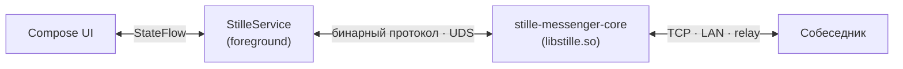

<p align="center">
  
</p>
<h1 align="center">Stille Messenger</h1>

<p align="center">
  Мессенджер для Android без серверов, со сквозным шифрованием.<br>
  Клиент демона <a href="https://github.com/puxxalwl/stille-messenger-core">stille-messenger-core</a>.
</p>

<p align="center">
  <a href="https://github.com/Puxxalwl/Stille-Messenger-Android/actions/workflows/ci.yml"></a>
  <a href="../LICENSE"></a>
  
  
</p>

<p align="center"><a href="../README.md">English</a> · <strong>Русский</strong></p>

---

## Что такое Stille


*Stille* — «тишина» по-немецки. Мессенджер соединяет два устройства
напрямую — по TCP, через обнаружение в локальной сети или самоподдерживаемый
relay — без серверов оператора посередине. В клиенте нет телеметрии,
аналитики и сторонних SDK.

Вся криптография, хранение сообщений и транспорт принадлежат
[ядру](https://github.com/puxxalwl/stille-messenger-core) — единственному
статическому бинарнику, который приложение запускает локально и опрашивает
через Unix-сокет. Клиент никогда не касается ключей и не пишет на диск
ничего в открытом виде.

## В этом клиенте

- Чаты с форматированием: жирный, курсив, зачёркивание, спойлер, код,
  ссылки — по UTF-8-диапазонам сущностей, безопасно для emoji.
- Реакции любыми emoji Unicode.
- Контакты через одноразовые или постоянные приглашения: QR со живым
  сканированием камерой, сохранённые QR-изображения, ссылки и deeplink-и
  `stille://`.
- Профиль с аватаром, который ядро хранит в зашифрованном виде.
- Восстановление аккаунта: passkey плюс один запечатанный ядром файл в
  собственном облаке возвращает личность на новое устройство — без истории
  сообщений ([подробнее](RECOVERY.md)).
- Самообновление: APK из GitHub Releases, проверяемые по контрольной сумме,
  сертификату подписи и версии до установки.
- Интерфейс на английском и русском.

Передача файлов (до 64 МБ) и голосовые звонки E2EE 16 кГц определены в API
ядра, но в этом клиенте ещё не реализованы.

## Архитектура



| Модуль | Роль |
|---|---|
| `app/` | Compose-интерфейс, foreground-сервис, восстановление и обновления |
| `data/` | Кодек бинарного протокола — зеркалит `CORE-API.md` байт в байт |
| `tools/` | Скрипты кросс-компиляции и релизов |
| `core-src/` | Исходники ядра (git-сабмодуль, не Gradle-модуль) |

Сервис запускает бинарник ядра из `nativeLibraryDir`, однократно создаёт
личность и транслирует события ядра в UI через `StateFlow`.
[Как устроен клиент](ARCHITECTURE.md).

## Документация

| Документ | Содержание |
|---|---|
| [USAGE.md](USAGE.md) | Использование: настройка, приглашения, профиль, обновления |
| [BUILD.md](BUILD.md) | Сборка, тесты, подпись и публикация релизов |
| [ARCHITECTURE.md](ARCHITECTURE.md) | Устройство клиента и граница с ядром |
| [RECOVERY.md](RECOVERY.md) | Церемония восстановления и хранилища |
| [UI-DESIGN.md](UI-DESIGN.md) | Направление интерфейса для контрибьюторов |
| [CONTRIBUTING.md](CONTRIBUTING.md) | Правила участия |
| [SECURITY.md](SECURITY.md) | Политика безопасности |
| [CHANGELOG.md](../CHANGELOG.md) | История релизов |

Спецификация протокола — в репозитории ядра:
[`core-src/core/docs/CORE-API.md`](../core-src/core/docs/CORE-API.md)
(англ.).

## Сборка

Нужны JDK 17, Android SDK и [Zig 0.17.0](https://ziglang.org/download/)
(только для кросс-компиляции ядра). Результат — APK для `arm64-v8a`.

```bash
bash ./tools/build-core.sh     # ядро → app/src/main/jniLibs/arm64-v8a/libstille.so
./gradlew :app:assembleDebug   # приложение
./gradlew :data:testDebugUnitTest :app:testDebugUnitTest   # тесты
```

Релизные сборки требуют подписного keystore — см. [BUILD.md](BUILD.md).

## Семья проектов

| Проект | Роль |
|---|---|
| [stille-messenger-core](https://github.com/puxxalwl/stille-messenger-core) | Zig-демон: криптография, хранение, транспорт |
| Stille Messenger (этот репозиторий) | Клиент для Android |
| [EryyynIT/shopot](https://github.com/EryyynIT/shopot) | Референсный Linux-клиент, Rust + iced |
| [stille.im](https://stille.im) | Сайт — домен приглашений работает только как редиректор |

## Участие

Перед PR прочитайте [CONTRIBUTING.md](CONTRIBUTING.md) — там перечислены
инварианты, которые проверяет ревью (без телеметрии, без криптографии в
клиенте, только бинарный протокол). Контракт для агентов и людей:
[AGENTS.md](AGENTS.md) (англ.).

## Лицензия

Оригинальный код Android-клиента — **AGPL-3.0-or-later**, Copyright (c) 2026
puxxalwl, EryyynIT. Форки и распространения сохраняют ту же лицензию и
указание авторов. См. [LICENSE](../LICENSE), [NOTICE](../NOTICE) и полный
текст в [LICENSE-AGPL-3.0.txt](../LICENSE-AGPL-3.0.txt). Сабмодуль
`core-src/` — независимый проект под собственной MIT-лицензией.
